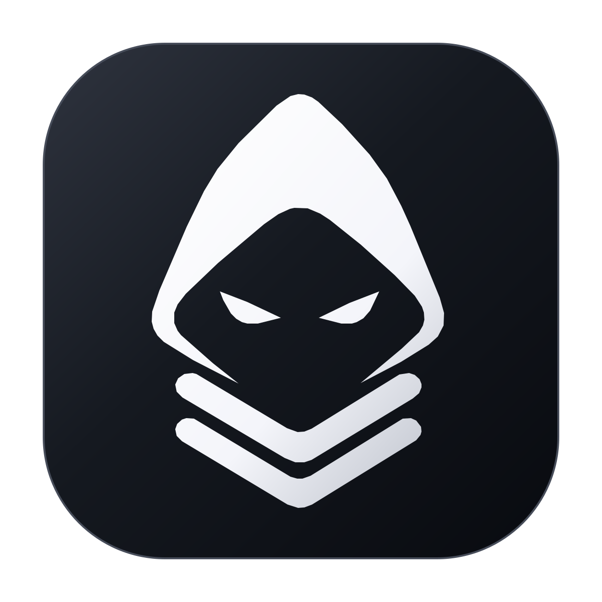
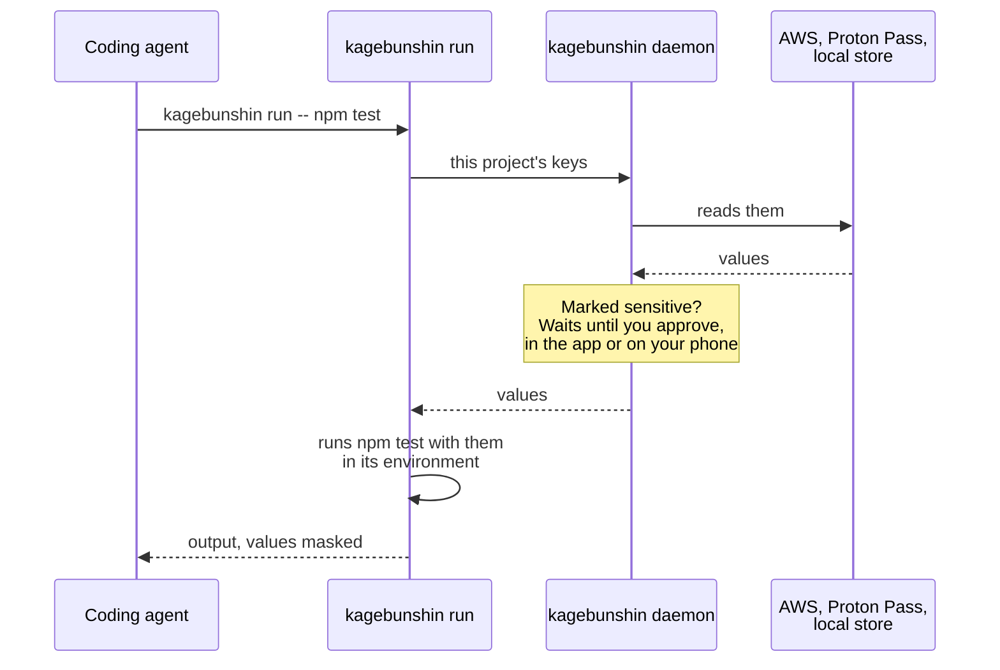
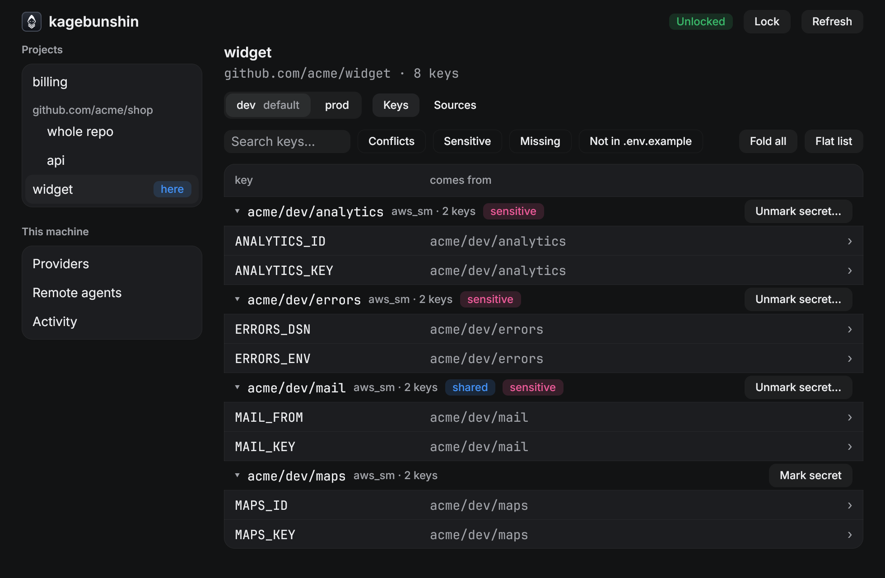
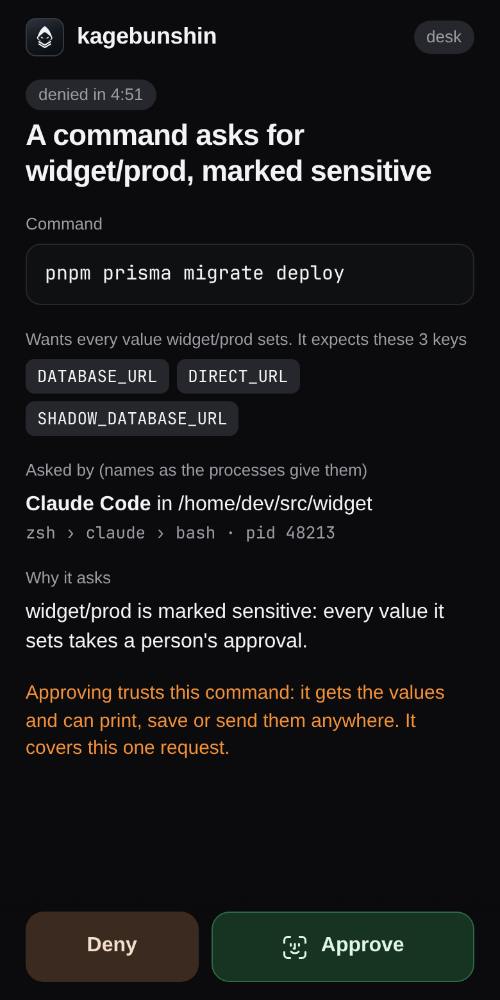

<p align="center">
  
</p>

<h1 align="center">kagebunshin</h1>

<p align="center">
  <b>Your coding agent runs your code with its secrets.<br>
  It never has to see one.</b>
</p>

<p align="center">
  <a href="https://github.com/oorestisime/kagebunshin/actions/workflows/ci.yml"></a>
  <a href="https://github.com/oorestisime/kagebunshin/releases"></a>
  
  <a href="LICENSE"></a>
</p>

<p align="center">
  <a href="#get-started">Get started</a> ·
  <a href="#why">Why</a> ·
  <a href="#how-it-works">How it works</a> ·
  <a href="#day-to-day">Day to day</a> ·
  <a href="#the-name">The name</a> ·
  <a href="#documentation">Docs</a>
</p>

---

kagebunshin is a local secrets broker for Linux and macOS. Secrets stay
where your team already keeps them: AWS Secrets Manager, a password
manager. When your agent runs a test or a dev server, that
command gets them in its environment. The agent knows they are provided.
It does not know what they are.

```console
$ git worktree add ../widget-fix && cd ../widget-fix
$ kagebunshin run -- npm test      # nothing to copy: the secrets are there
```

And what an agent gets back when a command it runs prints one:

```console
$ kagebunshin run -- sh -c 'echo "key is $API_KEY"'
key is <redacted:API_KEY>
```

## Why

I work with coding agents all day. They make worktrees, start new projects
and run my tests, and all of that needs secrets. I did not want to copy
`.env` files around for them, and I did not want my secrets in a
transcript or in a model's reasoning. An agent does not need to know a
secret, only that it is there.

- **Nothing to copy.** A project is known by its git remote, not by a
  file in a folder. A new worktree or a new clone has its secrets at once.
- **Nothing in the context.** There is no `.env` in the checkout to read
  or search. The agent sees the names of the keys and where each comes
  from, never a value, and values are masked in the output of what it
  runs.
- **From where the team keeps them.** Most teams share secrets in a
  password manager or a cloud secrets store, and then everyone pastes them
  into a `.env` anyway. kagebunshin reads them from there instead: AWS
  Secrets Manager and Proton Pass today, 1Password and Bitwarden
  planned. What lives nowhere else goes in a local encrypted store.
- **The agent does the work.** It sets a project up from one pasted line
  and runs everything through kagebunshin from then on. You are asked only
  for what shows a human is there: a passphrase, an approval.
- **Production waits for you.** What is marked sensitive, an agent cannot
  get by itself. The command waits while the app, or your paired phone,
  shows you what asks for which keys, and you approve that one request. Every refusal and every
  hand-out of a marked value goes in an audit log, by name.

<p align="center">
  
</p>

## How it works



The values go from where they live to the command that needs them. The
agent is on neither end of that: it starts the command and reads what
comes back.

## Get started

### 1. Install

```sh
curl -fsSLO https://raw.githubusercontent.com/oorestisime/kagebunshin/main/packaging/install.sh
sh install.sh
```

It asks you to choose a passphrase for the local store, starts the daemon,
gives OpenCode and Claude Code the kagebunshin skill and hooks when it
finds them, and on Linux puts the app in the tray.

### 2. Paste this into your agent

In a project's checkout:

```text
Set up kagebunshin here: run `kagebunshin next` and do what it says until it says done.
```

<details>
<summary>Or name several checkouts at once</summary>

```text
Set up kagebunshin in ~/code/widget and ~/code/blog: run `kagebunshin next ~/code/widget ~/code/blog` and do what it says until it says done.
```

</details>

The agent moves each `.env` into the encrypted store, which you approve
once in the app, by key name. A secret that is in no file you type into
the app when the agent asks for it, never into the chat. It drafts the
project from the checkout and the providers you use, proves it by running
your tests, and tells you what is left for you, such as the env files to
delete.

<p align="center">
  
</p>

### 3. That is it

In a worktree or another clone of that project there is
nothing to do. In a new project, paste the same line; where the hooks are
installed and the folder has a `.env` or a `.env.example`, the agent is
told to run it without you.

Another agent learns the commands from `kagebunshin init --agent`; see
[docs/agents.md](docs/agents.md#teach-the-agent). To do the setup yourself,
see [docs/manual-setup.md](docs/manual-setup.md).

## Day to day

| The agent | You |
|---|---|
| `kagebunshin run -- npm test`: a command, with its secrets | `kagebunshin unlock`, after a reboot or the idle timeout |
| `kagebunshin status`: which keys are set and where from, never a value | Approve a request for something marked sensitive, in the app or on your phone |
| `kagebunshin next`: what is left to set up, and whose step it is | `kagebunshin app`: keys by environment, sources, marks, the audit log |
| Marks what is production as sensitive | The only one who can remove a mark |

Start your agent as usual, not with `run`: that would put every value in
the agent's own environment. See [docs/agents.md](docs/agents.md) for the
rest, and [docs/app.md](docs/app.md) for the app and its tray.

<p align="center">
  
</p>

Agents on other machines can ask too, over an endpoint on your tailnet
that is off by default and where each machine needs a grant and its
token. See
[docs/config.md](docs/config.md#the-remote-endpoint).

A phone on your tailnet can approve as well. The app pairs it, and it
then approves a request on a page this machine serves it alone, with a
passkey: your face or fingerprint in place of the passphrase. It is
notified of a request, which then waits for it even with the app closed.
See
[docs/config.md](docs/config.md#the-approval-page).

<p align="center">
  
</p>

## What it does not do

> [!IMPORTANT]
> **Scoped, audited delivery, not invisibility.** kagebunshin decides which
> values reach which command and writes the decisions down. It does not make
> a value invisible to code that has it: a command that `run` starts can
> print its own environment, and approving a command trusts it. Masking
> covers the piped output of `run` and catches the accident, a value in a
> log line or a stack trace, not a determined reader.

On your own machine the boundary is soft: an agent runs as you and can use
your AWS profile without kagebunshin, so give agent-facing environments a
profile that cannot read production. For a boundary that holds, run the
agent on another machine and give it the remote endpoint. See
[docs/threat-model.md](docs/threat-model.md) for exactly what is and is not
protected.

## The name

影分身, *kage bunshin*, is the shadow clone technique from *Naruto*. A
ninja splits into copies, real ones that can act, and sends them off to
work at the same time. When a clone is done, what it learned comes back
to the original.

Coding agents are used the same way: several at once, each a clone of you
in a worktree of its own, doing part of your work. A clone needs what you
have to do that work. kagebunshin gives each clone's commands the secrets
they need and keeps the values with the original.

## Status

> [!NOTE]
> **Alpha**; the latest build is v0.0.1-alpha.16.

There are binaries for Linux x86_64 and aarch64 (glibc 2.35 or later)
and for macOS arm64. The macOS
binaries are unsigned, and no one has run them outside CI, which builds
and tests them: expect rough edges there.

AWS Secrets Manager and the local store are in daily use. Proton Pass
has handed values from a real vault to a bot on another machine, through
the remote endpoint; that is one run, not daily use yet. Approving on a
phone is new: an iPhone was paired, notified and approved requests, with
the app open and with it closed; that is a first run, not daily use
yet. The app is
experimental: its UI library is pinned to a
prerelease commit.

## Documentation

| Read | For |
|---|---|
| [Install](docs/install.md) | Install, upgrade, uninstall, from source |
| [Agents](docs/agents.md) | Running coding agents with kagebunshin, and what `kagebunshin next` does |
| [Manual setup](docs/manual-setup.md) | The same setup, by hand |
| [The app](docs/app.md) | The app, the tray and approvals |
| [Project files](docs/project-files.md) | Project mapping files, sources and sensitivity |
| [Configuration](docs/config.md) | `config.toml`, directories, environment variables, the service, the remote endpoint and the phone's approval page |
| [Threat model](docs/threat-model.md) | What is protected, from whom, and the known gaps |
| [Memory](docs/memory.md) | How values are kept in memory |
| [Roadmap](docs/roadmap.md) | What is agreed and not built yet |
| [Security](SECURITY.md) | Reporting a vulnerability |

## License

[MIT](LICENSE).
