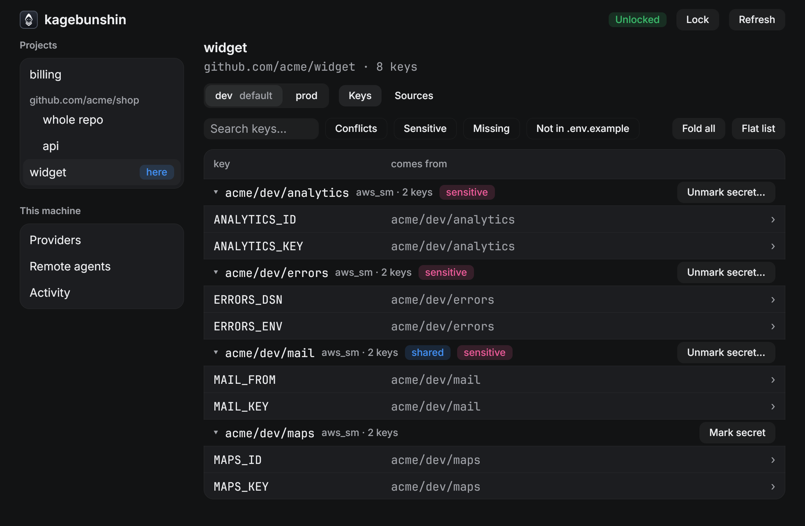
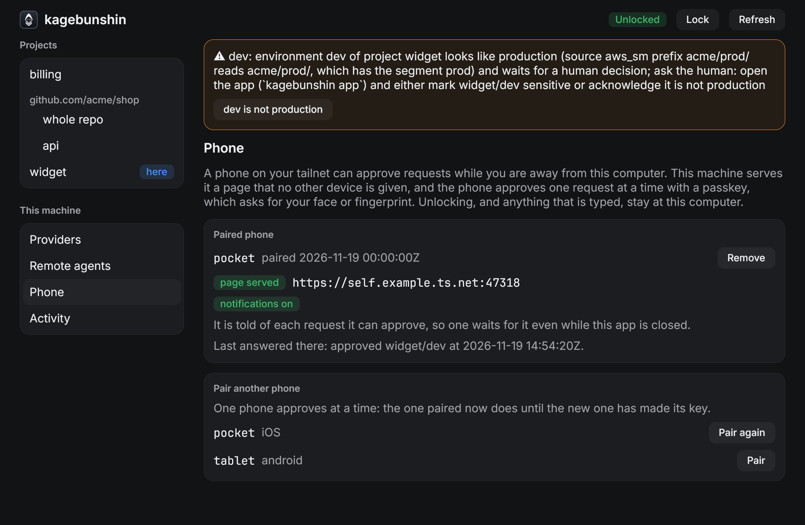

# The app

`kagebunshin app` (experimental: its UI library is pinned to a prerelease
commit) opens a window on your projects. Pick a project, then one of its
environments: its keys are listed a row each, grouped by the secret that
sets them, with where each comes from and never its value. A row opens the
key's page, and Sources lists what the environment reads, in order.
An environment that looks like production and waits for your decision
loads only when you ask; those waiting are listed together, each with its
two choices. One you acknowledged as not production loads like any other
and says so above its keys, with the button that takes it back. With the
passphrase, it shows an environment marked sensitive or reveals one value,
until you hide it.

<p align="center">
  
</p>

Under the projects is what belongs to the machine and to no project:
Providers, Remote agents, Phone and Activity. Providers has a card for each provider: whether it
can read now, the environments that read from it and how much each reads,
and how to connect it. AWS is checked once for each profile and region an
environment reads with, and a profile whose login ran out has its Log in
button beside it. Remote agents says whether the
[remote endpoint](config.md#the-remote-endpoint) listens and lists the
machines it lets in. Each grant can be revoked there, or given a new
token, which shows once and takes the passphrase. Phone pairs the phone
that approves requests through the
[approval page](config.md#the-approval-page): it lists the tailnet's
phones, and pairing one takes the passphrase and shows a code for the
phone to scan, until the phone has made its key or the view is left. It
then names the paired phone, says whether its page is served, whether
the phone is notified of requests and what was last answered there, and
removes it. Activity is the audit
log of every project or of one; the runs that needed no approval are not
in it, and `kagebunshin audit --all` lists them.

<p align="center">
  
</p>

Keep agents away from what matters by marking environments, secrets or
store keys sensitive in the app. Each change takes the passphrase. A
secret is marked and unmarked on its header in the key list, beside the
`sensitive` tag. Unmarking lists the environment's other marked secrets
too, so you can tick several and unmark them with one passphrase. A line
names what changed and goes after a few seconds; one with a warning, or a
failure, stays until you dismiss it. While the app runs, it is also where
you approve or deny a command that needs a marked value (the paired phone
can answer that one too), approve an import
of env files an agent asks for, and type the secret values an agent asks
you for; with the app not running, such a command is refused, unless it
is one the paired phone can approve and the phone is notified of it.

On Linux the app stays in the tray: closing the window hides it, and the
tray icon or another `kagebunshin app` brings it back. A command that
needs your approval sends a notification, every time and wherever the
window is, and waits in the window, which is not brought up for it: the
tray icon opens it. It waits
five minutes for your answer (`approval_timeout` in `config.toml` sets how
long). The window asks one question: who asks, the command, the keys it
gets in one line and the time left. Details opens the rest: every key, the
processes the request came through, why it asks and what approving does. A `kagebunshin store set` run with no terminal
asks for values: the window has a hidden field for each key, says which
keys have a value that yours would replace, and Save writes what you typed
with the passphrase; a field left empty leaves its key as it was. Closing
the window on a request denies it. Quit from the tray menu or with `kagebunshin app --quit`;
`kagebunshin app --hidden` starts it in the tray with no window, which is
how it starts at login: `kagebunshin setup` writes a launcher entry and a
login entry for it, and the first time, when it creates the store, starts
it in the tray (`kagebunshin app install` writes only the entries, and
`kagebunshin app uninstall` removes them). Where there is no tray (macOS,
or a desktop with no tray host), closing the window ends the app.

`kagebunshin app` returns to the prompt once the app is up. Where the
daemon is a systemd user service the app is one too,
`kagebunshin-app.service`: it is restarted if it fails, upgrading with
`install.sh` restarts it on the new build, and
`journalctl --user -u kagebunshin-app` has what it printed.

```sh
kagebunshin app
kagebunshin audit --since 1d
```
