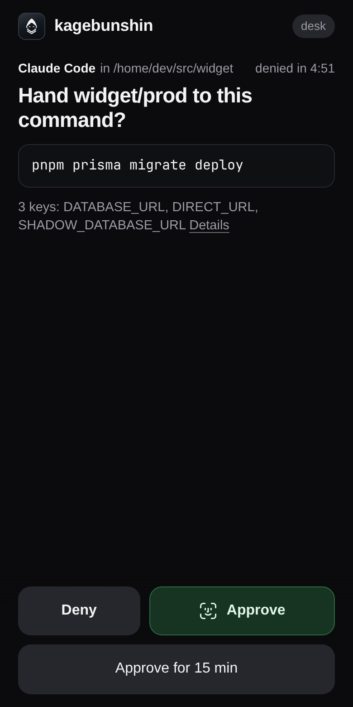

# Configuration

## Where things live

```text
$KAGEBUNSHIN_CONFIG_DIR, else $XDG_CONFIG_HOME/kagebunshin, else ~/.config/kagebunshin
├── config.toml          optional; below
├── store.age            the local encrypted store
└── projects/
    └── <name>.toml      one per project; see project-files.md

$XDG_STATE_HOME/kagebunshin, else ~/.local/state/kagebunshin
├── audit.jsonl          the audit log, mode 0600, rotated to audit.jsonl.1 at 10 MiB
├── runs.jsonl           the runs that needed no approval, kept the same way
├── proofs.json          the last `run --strict` that worked, per environment
├── push.json            what notifies the paired phone: this machine's key for
│                        notifications and what the phone's browser gave for them
├── imported.json        the env files `onboard` imported and left in place:
│                        path, size and time, so they are not named again
└── left-out.json        the app folders `onboard --exclude` left out, so
                         they stay out when their checkout is set up again

Socket: $KAGEBUNSHIN_SOCKET, else $XDG_RUNTIME_DIR/kagebunshin/kagebunshind.sock
        (Linux) or $TMPDIR/kagebunshin/kagebunshind.sock (macOS)
```

The same layout is used on Linux and macOS. The daemon reads the config
directory again on every request, so edits apply without a restart.

## `config.toml`

Every field but `schema` has a default; a missing file means all defaults.
Unknown fields are refused.

```toml
schema = 1

default_env = "dev"           # the environment used when --env is not given
idle_timeout = "30m"          # lock after this long without a request; s, m, h or d, at most 30d
approval_timeout = "5m"       # deny a request nobody answers after this long; s or m, at most 30m
default_provider = "file"     # the source an environment with none gets: "file" (the store) or "aws_sm"
strict_memory = false         # refuse values that cannot be locked in memory, rather than warn

# Extra globs (`*` only) for names that look like production. An environment
# they match waits for a human decision. See project-files.md.
sensitive_source_patterns = ["*-prod*"]

[masking]
min_len = 8                   # values shorter than this are not masked in piped output

[remote]
port = 47317                  # the remote endpoint's TCP port, and the one --machine connects to

[phone]
port = 47318                  # the approval page's TCP port
```

## The logs

What is recorded is not a setting. Sensitive access, every denial and
every change go in `audit.jsonl`. A run that needed no approval goes in
`runs.jsonl` beside it, a file of its own so that ordinary use, however
much, pushes nothing out of the audit log. Both hold names, never values.

```sh
kagebunshin audit --since 1d                     # the audit log
kagebunshin audit --all --since 1d               # and the ordinary runs
kagebunshin audit --all --action run --project widget --env dev
```

`kagebunshin status` says how many runs got their values in the last day:
across every project outside a checkout, of the environment on show in
one.

## Environment variables

| Variable | |
|---|---|
| `KAGEBUNSHIN_CONFIG_DIR` | the config directory |
| `KAGEBUNSHIN_SOCKET` | the socket path, absolute |
| `KAGEBUNSHIN_LOG` | the daemon's log filter (`tracing` syntax), default `info` |
| `XDG_CONFIG_HOME`, `XDG_STATE_HOME`, `XDG_RUNTIME_DIR`, `TMPDIR` | as above |

AWS sources use the usual AWS configuration (`AWS_CONFIG_FILE`,
`AWS_PROFILE`, SSO caches and so on) as the daemon sees it.

## The daemon as a service

`kagebunshin setup` does this, after creating the config directory and
the store, and then unlocks the daemon; `--no-service` skips the service
and unlocks a daemon you run yourself. Run again, it asks for the existing
passphrase and checks it before reinstalling.

On Linux, where `kagebunshin-app` is installed, `setup` also writes what
`kagebunshin app install` writes: a launcher entry
(`~/.local/share/applications/io.github.oorestisime.kagebunshin.desktop`),
a login entry that starts the app in the tray
(`~/.config/autostart/io.github.oorestisime.kagebunshin.desktop`) and the
icon both name, under `~/.local/share/icons/hicolor/`. The entries run the
installing binary's `app` on the socket the install resolved. Each file is
marked as kagebunshin's; one of the same name that is not, or a symlink,
is left alone. `--no-service` skips them too, and `kagebunshin app
uninstall` removes them. To keep the app out of login, replace the login
entry with one of your own that says `Hidden=true`.

`kagebunshin app` starts the app, waits until it is up and returns to the
prompt; `--hidden` starts it in the tray with no window. Where the daemon
is a systemd user service for the same socket, the app is started as one
beside it, `kagebunshin-app.service`:

- It is a transient unit, made with `systemd-run` when the app is asked
  for, so there is no unit file. It is given the display, session bus and
  desktop variables of the session that asked, and otherwise the service
  manager's environment.
- A failed app is restarted, at most five times in thirty seconds, and it
  stops with `graphical-session.target`. What it prints is in
  `journalctl --user -u kagebunshin-app`.
- `setup`, and so an upgrade with `install.sh`, restarts a running app on
  the new build, as it does the daemon; so does `app install`. An app that
  was started some other way is told to quit and started as the unit.
  With no app running, none is started, except by the `setup` that
  creates the store, in a session with a display: the first import an
  agent asks for waits in the app for your approval.
- `kagebunshin uninstall` stops it.

With `--no-service`, and on macOS, the app is instead started in a session
of its own, so Ctrl+C in the terminal and closing it do not end the app,
and nothing restarts it.

`kagebunshin daemon install` writes a systemd user unit,
`~/.config/systemd/user/kagebunshin.service`, or a launchd agent,
`~/Library/LaunchAgents/io.github.oorestisime.kagebunshin.plist`, that runs
the installing binary on the socket the install resolved, and starts it.
The daemon starts locked, so reinstalling locks it. `daemon status` shows
whether it is installed and answering; `daemon uninstall` removes it.
Logs go to the journal (`journalctl --user -u kagebunshin`) or to
`~/Library/Logs/kagebunshin/daemon.log`.

The service does not inherit your shell's environment. Only the socket
path is written into the unit, so:

- A custom `KAGEBUNSHIN_CONFIG_DIR`, `XDG_CONFIG_HOME` or `XDG_STATE_HOME`
  is not seen by the service, which then uses the default directories.
  Run the daemon yourself (`kagebunshin daemon &`) if you need them.
- `PATH` is the service manager's, not yours. An AWS profile that uses
  `credential_process` with a program found through your `PATH`, or
  `AWS_PROFILE` and other `AWS_*` variables set in your shell, will not
  work from the service. SSO profiles (`aws sso login`) work, since they
  read the cache under `~/.aws`. Use absolute paths in `credential_process`.
- On Linux, raise the locked-memory limit with `LimitMEMLOCK=` in a drop-in
  if you hold many values; see [memory.md](memory.md#the-budget).

## The remote endpoint

Another machine on your tailnet can run `run`, `status` and `diff`
against this daemon, so a bot there needs none of your credentials. It is
off until you turn it on, and each machine needs a grant and the grant's
token:

```sh
kagebunshin remote enable                        # asks for the passphrase
kagebunshin remote grant laptop widget dev ci    # project widget, envs dev and ci; prints the token
kagebunshin remote grant laptop widget dev --until 2026-12-31
kagebunshin remote rotate laptop widget          # a new token, ending the old one
kagebunshin remote revoke laptop [widget]
kagebunshin status                               # where it listens, and the grants
```

On the other machine, with the token `remote grant` printed:

```sh
export KAGEBUNSHIN_REMOTE_TOKEN=kbr_…
kagebunshin run --machine desk -- npm test
kagebunshin status --machine desk
kagebunshin diff --machine desk
kagebunshin run --machine desk --project widget -- ./bot   # in any folder
```

- The daemon listens on this machine's IPv4 tailnet address and `[remote]
  port` only, while the store turns it on, the daemon has been unlocked
  and Tailscale is running. It never falls back to another address; when
  it cannot listen, `status` says why.
- Each connection is identified by the local tailscaled (machine, user,
  tags). One it cannot identify, and this machine itself, are refused.
- A grant holds the machine's Tailscale node id, so a different machine
  renamed to the granted name gets nothing. Grants and the on/off switch
  live in the encrypted store, so each change takes the passphrase.
- A grant has a token, which the machine sends with every request as
  well as being the machine Tailscale says it is. `remote grant` and
  `remote rotate` print it once, and the store keeps only its hash:
  rotate for a new one if it is lost. Granting again replaces the grant
  and its token. A grant made before tokens lets nothing through until it
  is rotated or made again. The token is not the store's passphrase and
  unlocks nothing here. `run` takes it out of the environment of the
  command it starts.
- The app lists the grants under Remote agents, where each can be given a new
  token or revoked. Making one stays with `remote grant`.
- In a checkout the project is found by its git remotes, as it is
  locally. With `--project` the name is enough, in any folder and with no
  git installed: the remotes are only what the other machine reports, and
  the grant already says which projects it may use. Of a project no grant
  of its names, a machine learns nothing, not even whether there is one.
- A locked daemon refuses remote callers, and they cannot unlock it.
  Their requests do not reset the idle timeout. What fixes a refusal
  (unlocking, opening the app, a grant) is done on this machine, and the
  caller is told so.
- Values marked sensitive still need approving here, in the app or on
  the [paired phone](#the-approval-page). The
  prompt names the machine and its user, and shows the command line as
  that machine reported it: nothing here can check it. Each machine has
  at most one prompt waiting; a second request is refused.
- Every remote request is in the audit log, with the machine, its user
  and tags.
- `--machine` finds the machine through this machine's tailscaled, and
  uses this machine's `[remote] port`. Where there is no tailscaled, as in
  a sandbox that reaches the tailnet through a proxy, give the machine's
  full name (`desk.example.ts.net`), which is looked up like any other.
- The endpoint is HTTP: `POST /v1` with a request as JSON, answered with
  a reply as JSON, the token in `Authorization: Bearer`, and the caller's
  build in `kagebunshin-build`, which has to be the daemon's. While a
  `run` waits for approval the reply stays open, with a newline every 15
  seconds. It is plain HTTP on the tailnet, which Tailscale encrypts
  between the two machines; see
  [threat-model.md](threat-model.md#remote-callers) for what that leaves.

## The approval page

A phone on your tailnet can approve a request for values marked
sensitive, so you need not be at this computer's keyboard. The daemon
serves that one phone a small page, and the phone approves one request at
a time with a passkey, which asks for your face or fingerprint. Nothing
is installed on the phone but Tailscale.

<p align="center">
  
</p>

It needs:

- Tailscale on the phone, signed in to the same tailnet, and a tailnet
  policy that lets the phone reach this machine on `[phone] port`.
- MagicDNS and HTTPS certificates turned on for the tailnet, in
  Tailscale's admin console. A browser makes a passkey only on a page it
  reached over HTTPS under a name, and that name is this machine's on the
  tailnet. Tailscale has the certificate issued, which puts the machine's
  tailnet name in the public certificate logs.
- On Linux, a user tailscaled gives certificates to: root, or the
  operator (`sudo tailscale set --operator=$USER`).

Pair the phone in the app, under Phone: pick it among the tailnet's
phones and tablets, give the passphrase, and point the phone's camera at
the code the app shows. The page there makes the passkey, its approval
key.

To be told of a request, turn notifications on on the page. An iPhone
allows that only for a page on its home screen: open the page in Safari,
choose Share, then Add to Home Screen, open Kagebunshin from there and
tap Turn on. Other phones ask in the browser.

```sh
kagebunshin status
# phone: pocket approves at https://desk.example.ts.net:47318
#   notifications: on
#   last answered there: approved widget/dev at 2026-11-19 14:54:20Z
```

- The page is served on this machine's IPv4 tailnet address and `[phone]
  port` only, while a phone is paired or being paired, the daemon is
  unlocked and Tailscale is running. A locked daemon serves nothing: it
  cannot read which phone is paired. When the page cannot be served,
  `status` and the app say why.
- Only the paired phone gets the page, and for the ten minutes a pairing
  lasts the phone being paired. The daemon asks tailscaled who each
  connection is, as it does for the remote endpoint; every other machine
  is refused.
- One phone is paired at a time. Pairing another replaces it once the new
  one has made its key; until then the old one still approves. The app
  removes it, with the passphrase. The pairing is in the encrypted store:
  the phone's name and Tailscale node id, and its passkey's public key,
  which is no secret.
- A request shows on the phone as it does in the app: who asks, the
  command, the keys it gets in one line and the time left, with the rest
  under Details, by name and never a value. Approve asks for the passkey; Deny asks for nothing, as
  in the app. The first answer counts, wherever it is given, and the
  other side says where that was.
- Where the request is a coding agent's or another machine's, "Approve
  for 15 min" approves it and lets that agent have the same environment
  again for 15 minutes without asking, as the app's button does. The
  page lists what stands, with an End button that asks for nothing.
- The phone approves hand-outs only. Unlocking, an import, values an
  agent asks you to type, removing a mark and the grants stay at this
  computer, with the passphrase; the page shows an import or a request to
  type values as waiting at the computer, and can deny it.
- A phone that allowed notifications is told of each request it can
  approve as the request starts waiting, and tapping the notification
  opens the page on that request. With notifications on, such a request
  waits for the phone even when the app is not running on this computer.
  If the notification cannot be handed over and the app is not open, the
  request is refused as before, and `status` and the app say why the
  last one did not go out. A request that takes the passphrase still
  needs the app.
- A notification names what the page's title does, the project and
  environment and for another machine's request that machine, and the
  program that asks, not its arguments. It goes through the push service
  of the phone's browser (Apple's for an iPhone), encrypted to the
  phone: the service learns that this machine sent that phone something,
  and when. The daemon sends only to the push services of Apple, Google,
  Mozilla and Microsoft.
- What notifying takes is in `push.json` in the state directory, not in
  the store, because the phone gives it after pairing, with nobody at
  this computer to type the passphrase: this machine's key for
  notifications and the address and key the phone's browser gave.
  Removing the phone or pairing one again drops what the phone gave.
- Each answer given on the phone is in the audit log (`phone approve`,
  `phone deny`), with the phone and its user as Tailscale names them, and
  so is each pairing.
- Changing `[phone] port` moves the page: `status` gives its new
  address, which the phone opens in place of the one it kept. Its passkey
  is for this machine's name, so it goes on working there.

See [threat-model.md](threat-model.md#the-paired-phone) for what an
approval there rests on.
